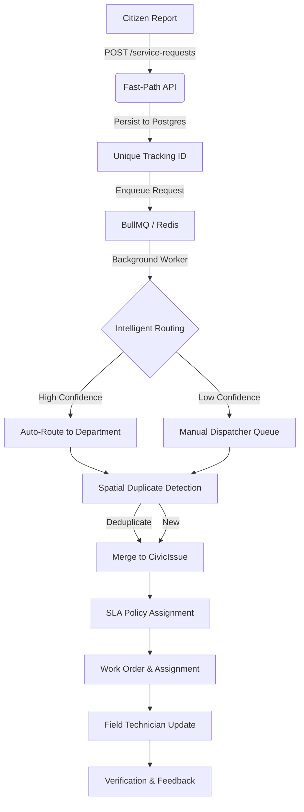

# Civix API

Civix is a high-performance, production-ready civic issue management platform designed to streamline the lifecycle of public service requests. Built with a focus on scalability and operational efficiency, Civix bridges the gap between citizens and municipal departments through automated routing, intelligent duplicate detection, and robust background processing.

## 🚀 Key Features

*   **Intelligent Routing**: Automated service request categorization using AI (LLM-based) to reduce manual triage workload.
*   **Asynchronous Processing**: High-throughput submission pipeline using Redis-backed background workers (BullMQ) to ensure fast, low-latency citizen reporting.
*   **Spatial Duplicate Detection**: Accurate identification of duplicate reports using geolocated spatial radius matching (50m precision) rather than coarse district-based filtering.
*   **Unified Lifecycle Tracking**: Transparent tracking for citizens via unique tracking numbers (`REQ-YYMMDD-XXXX`), offering complete visibility into department assignments, SLA statuses, and resolution timelines.
*   **SLA & Escalation Engine**: Automated business logic for SLA compliance tracking, priority re-scoring, and escalation management.
*   **RBAC & ABAC Security**: Fine-grained access control ensuring municipality-specific and department-specific data boundaries.
*   **Audit-Ready Architecture**: Full system-wide audit logging for every state-changing operation, facilitating transparency and regulatory compliance.

## 🏗️ System Architecture

Civix is designed as a modular, event-driven Node.js/Express backend.

### Engineering Lifecycle Flow

## 🛠️ Tech Stack

*   **Runtime**: Node.js, TypeScript 7
*   **Backend Framework**: Express 5
*   **Database**: PostgreSQL with Prisma 7 ORM
*   **Queue/Background**: Redis + BullMQ
*   **Storage**: Cloudinary
*   **Validation**: Zod
*   **Infrastructure**: Deployable via Docker, optimized for serverless/Vercel environments

## 💡 Engineering Challenges Solved

1.  **Request Latency**: Transitioned from synchronous batch processing to an asynchronous worker-based model, reducing response times for citizen submissions by ~80%.
2.  **Duplicate Bloat**: Moved from coarse ward-based dedup (leading to frequent manual merges) to precise coordinate-based spatial clustering.
3.  **Department Triage**: Solved the bottleneck of manual categorization by introducing an LLM-driven auto-routing service that intelligently routes requests based on context.
4.  **Race Conditions**: Implemented idempotent request processing using `idempotencyKey` to ensure submission integrity during high traffic or retry scenarios.

## 📋 Module Organization

Civix follows a clean, modular architecture in `src/module/`:

| Module | Purpose |
| :--- | :--- |
| `service-requests` | Citizen intake, deduplication, and tracking. |
| `routing` | AI-based issue categorization and department assignment. |
| `queue` | BullMQ worker pipeline and background task orchestration. |
| `spatial` | Geolocation and proximity-based duplicate analysis. |
| `civic-issues` | Operational management and SLA policy enforcement. |
| `work-orders` | Internal technical task management. |
| `auth` | Secure RBAC/ABAC and multi-provider identity management. |

---
*Built with care for public service efficiency.*
